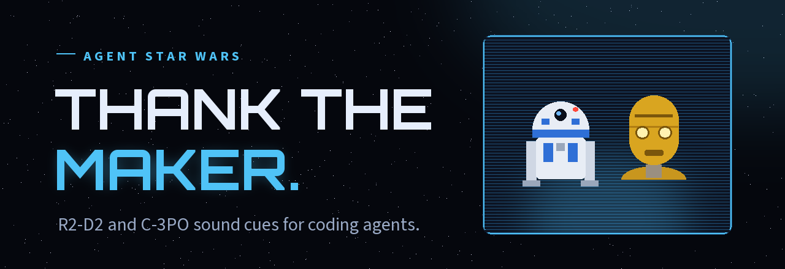
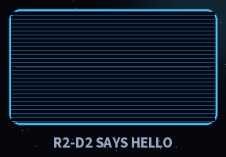
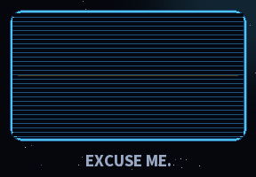
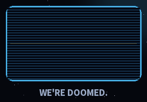
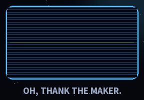
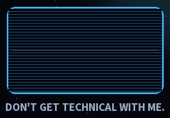
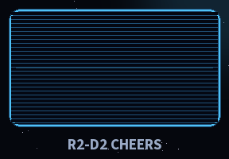

<h1 align="center">
  <a href="https://mitchtech.github.io/agent-starwars/"></a>
</h1>

<p align="center">
  <a href="https://github.com/mitchtech/agent-starwars/actions/workflows/check.yml"></a>
  <a href="https://github.com/mitchtech/agent-starwars/releases/latest"></a>
  <a href="LICENSE"></a>
  <a href="audio/NOTICE.md"></a>
</p>

<p align="center"><b>Your coding agent says <i>Oh, thank the Maker.</i> when it finishes and <i>We're doomed.</i> when an approval is for <code>rm -rf</code>. R2-D2 handles the beeps.</b></p>

<p align="center">
  <a href="https://mitchtech.github.io/agent-starwars/"><b>Hear every clip</b></a> ·
  <a href="#sounds">Event map</a> ·
  <a href="#droids">Duo mode</a> ·
  <a href="https://github.com/mitchtech/agent-starwars/releases">Releases</a> ·
  <a href="https://github.com/mitchtech/agent-warcraft">Agent Warcraft</a> ·
  <a href="https://github.com/mitchtech/agent-navi">Agent Navi</a> ·
  <a href="https://github.com/mitchtech/agent-johnny5">Agent Johnny 5</a>
</p>

<table align="center">
  <tr>
    <td align="center"><br><sub>Session start</sub></td>
    <td align="center"><br><sub>Approval</sub></td>
    <td align="center"><br><sub>Destructive command</sub></td>
    <td align="center"><br><sub>Turn finished</sub></td>
    <td align="center"><br><sub>Prompt spam</sub></td>
    <td align="center"><br><sub>R2-D2 mode</sub></td>
  </tr>
</table>

R2-D2 and C-3PO sound notifications for coding agents. Native sound
integrations for **Claude Code**, **Codex**, and **Gemini CLI**, plus a small
event interface for other agents and scripts. One shared player supports macOS,
Linux, and Windows. Codex pet slots for both droids are ready and waiting for
art.

Agent Star Wars plays 75 clips, 25 from R2-D2 and 50 from C-3PO, on agent events:

- R2-D2 whistles hello when a session starts and chirps when you send a prompt.
- C-3PO says "Excuse me." when an approval is waiting, and "We're doomed." or
  "This is madness!" when that approval is for `rm -rf`, a force push, or a
  dropped table.
- "Oh, thank the Maker." when a turn finishes.
- "I'm doomed." when Claude Code stops on a rate limit or billing error, and a
  line that cuts off mid-sentence when a reply hits the output token limit.
- "Don't get technical with me." when you send three prompts in ten seconds.

By default the droids split the work (**duo** mode): R2-D2's short beeps take
the frequent, low-stakes cues and C-3PO speaks when you should look up. Switch
to `r2d2` for beeps only, `c3po` for C-3PO only, or `both` for a random mix. It
runs locally, sends no telemetry, and never approves or blocks an agent's actions.

A sibling of [Agent Warcraft](https://github.com/mitchtech/agent-warcraft),
[Agent Navi](https://github.com/mitchtech/agent-navi), and
[Agent Johnny 5](https://github.com/mitchtech/agent-johnny5), inspired by
[thephw/claude-meseeks](https://github.com/thephw/claude-meseeks).

## Choose your setup

| Choice | Install | Requirements |
|---|---|---|
| Sounds | [Agent plugin](#install) or standalone CLI | Node.js 22+ and local audio |
| Power meter | [Status line command](#power-meter-and-usage-alarms) | Claude Code status line |
| Codex pets | [Coming soon](#codex-pets) | A host with compatible custom pets |

Installing the sound plugin never installs or selects a pet, and never changes
your status line.

## Sound requirements

- **Node.js 22 or newer**, with `node` on the agent's `PATH`.
- **macOS:** built-in `afplay`.
- **Linux:** `paplay`, `pw-play`, `aplay`, or `ffplay`, with a working local audio device.
- **Windows:** Windows PowerShell (`powershell.exe`), using `System.Media.SoundPlayer`.

No npm runtime dependencies, Bash, or `jq` are required. Windows hooks and audio
playback do not require Git Bash. A headless machine without an audio device
cannot play sounds on your laptop automatically.

## Install

### Claude Code

```bash
claude plugin marketplace add mitchtech/agent-starwars
claude plugin install starwars@agent-starwars
```

Inside a Claude Code session, the same steps are `/plugin marketplace add` and
`/plugin install`.

### Codex

```bash
codex plugin marketplace add mitchtech/agent-starwars
codex plugin add starwars@agent-starwars
```

Review and trust the installed hooks in Codex's hook settings before using them.
Installing or enabling the plugin does not automatically trust its hook commands.
Restart the agent after installation or updates.

### Gemini CLI

```bash
gemini extensions install https://github.com/mitchtech/agent-starwars
```

Gemini selects a self-contained ZIP for your platform from GitHub Releases.
Review the extension's hook consent prompt and restart Gemini. For local
development:

```bash
npm run gemini
gemini extensions link ./dist/gemini
```

The repository root is for shared sources and discovery; Gemini's executable
hook file is included in the generated extension, not the source root. Install
published release assets rather than linking the repository root or a raw Git
branch. See [Gemini integration](docs/gemini.md).

### Running alongside the sibling plugins

Agent Warcraft, Agent Navi, Agent Johnny 5, and Agent Star Wars respond to the
same events. Enable one per host unless you want a peon, a fairy, a robot, and
two droids talking over each other. For example,
`claude plugin disable warcraft@agent-warcraft` for Claude Code, or
`enabled = false` under `[plugins."warcraft@agent-warcraft"]` in
`~/.codex/config.toml` for Codex.

### Local development

```bash
git clone https://github.com/mitchtech/agent-starwars.git
cd agent-starwars
node scripts/starwars.mjs doctor
```

Use `claude plugin marketplace add /absolute/path/to/agent-starwars` for Claude Code or
`codex plugin marketplace add /absolute/path/to/agent-starwars` for Codex, followed by
the same plugin installation command above. `claude --plugin-dir /absolute/path/to/agent-starwars`
tries it for one session without installing.

### Standalone command

For the `agent-starwars` command outside an agent plugin:

```bash
npm install -g github:mitchtech/agent-starwars
agent-starwars doctor
agent-starwars play approval_required --session my-session --tool Bash
agent-starwars preview c3po-thank-the-maker
```

All commands also work as `node /path/to/agent-starwars/scripts/starwars.mjs ...`.
Standalone `play` and `preview` wait for the short clip; native hooks dispatch
playback to a detached worker so the agent can continue immediately.

## Codex pets

R2-D2 and C-3PO Codex pets are on their way. The pet slots ship ready:
`agent-starwars pet status` (R2-D2) and `agent-starwars pet status c3po` report
`not-bundled` and change nothing, and `pet install` explains that the art is not
bundled yet. When the art lands, the same commands install it, and releases
gain `agent-starwars-r2d2-pet.zip` and `agent-starwars-c3po-pet.zip`. Until
then, Codex's [native pet feature](https://learn.chatgpt.com/docs/pets) can
create one. See [pets](docs/pets.md).

## Sounds

Each event lists the R2-D2 sound first, then the C-3PO lines. **Duo** is who
speaks by default.

| Shared event | When | R2-D2 / C-3PO | Duo | Default |
|---|---|---|---|---|
| `session_started` | A session starts, resumes, or clears | greeting whistle, burst of beeps / "Oh, hello. I am C-3PO. How may I be of assistance?" "I am glad you are here." "Greetings." | R2 | On |
| `prompt_submitted` | You send a prompt | three affirmative chirps / "I can certainly be of assistance here." "I believe this is where I come in." "I see your point, sir." | R2 | On |
| `annoyed` | Your third prompt inside ten seconds | indignant raspberry, angry blat / "Don't get technical with me." "I'm sure it must be your fault." "How rude!" "This time you have gone too far." and more | 3PO | On |
| `approval_required` | A tool needs permission | insistent attention beeps / "Excuse me." "Would you assist me, please?" "Did you hear that?" "All systems have been alerted to your presence, sir." | 3PO | On |
| Approval for shell commands or file edits | | curious warble / "Be careful. I am rather attached to all my parts." "Goodness gracious me." "Please be careful." | 3PO | On |
| Approval for a destructive command | | alarmed warble, R2 scream / "We're doomed." "This is madness!" "Oh no! I'm under attack!" | 3PO | On |
| `input_required` | The agent asks you a question | questioning beep / "What are you talking about?" "What is that?" "What is happening?" | 3PO | On where available |
| `ready_for_input` | Claude Code is idle and waiting | thoughtful burble / "At last! Where have you been?" "Artoo, do you think they have forgotten about us?" | 3PO | On for Claude |
| `turn_completed` | The agent finishes responding | excited trill, happy whistle / "Oh, thank the Maker." "Oh, how wonderful!" | 3PO | On |
| `out_of_power` | Rate limit, billing error, account on hold, or budget spent | sad descending whistle / "We're doomed." "I'm doomed." "What have I done to deserve this?" | 3PO | On for Claude |
| `power_low` | The power meter crosses its threshold | worried warble / "This looks very bad." "My sensors tell me enemies are approaching." | 3PO | On with the meter |
| `transmission_cut` | A reply hits the output token limit | electrocuted static / "I'm not quite sure if you..." "I will try again." | 3PO | On for Claude |
| `error` | Claude Code stops on any other API error | R2 scream / "That was very unpleasant." "I wasn't built for this!" | 3PO | Off |
| `tool_failed` | A tool call fails | short raspberry / "Oh dear." "I have not been programmed to do this, I'm afraid." | R2 | Off |
| `subagent_started` | A subagent starts work | rolling-off chirp / "If we must embark on a mission together, could I please ask that you refrain from pulling me apart?" | R2 | Off |
| `context_compacting` | Context is about to be compacted | pondering chatter / "Where did I go?" | 3PO | Off |
| `session_ended` | A session ends | power-down moan / "What a traumatic experience." "Good day." | R2 | Off |
| Easter egg | | R2 laughing, R2 singing / "I am terribly sorry, but I am not the droid you're looking for." "I am fluent in over six million forms of communication." and more | Both | 2% of session, prompt, ready, and completion cues |

`turn_completed` is on by default: "Thank the Maker" is the line people install
this for. `agent-starwars preset attention` turns it off.

**Destructive commands** are recognized from the approval request's command:
`rm` with recursive and force flags, `git push --force` or `-f` (not
`--force-with-lease`), `git reset --hard`, `git clean -f`, `DROP TABLE`/`DATABASE`/`SCHEMA`,
`TRUNCATE TABLE`, `mkfs`, `dd of=`, `chmod -R 777`, `Remove-Item -Recurse -Force`,
and `rmdir /s`. The alarm is a louder cue, not a safety check: it never blocks,
approves, or logs the command. Only a yes/no flag leaves the hook process.

**Annoyed** lines replace the third and later prompts sent within ten seconds
in the same session. Only timestamps are stored, never prompt text. Turn them
off with `agent-starwars mute annoyed`.

**Easter eggs** never replace approval, question, error, or destructive-command
cues. Turn them off with `agent-starwars mute easter-egg`.

Subagent completion is silent. Idle/input notifications and completion events
are distinct; event availability depends on the host. See
[compatibility](docs/compatibility.md).

## Droids

```bash
agent-starwars droid duo     # R2-D2 for frequent cues, C-3PO for attention (default)
agent-starwars droid r2d2    # beeps and whistles only
agent-starwars droid c3po    # C-3PO for everything
agent-starwars droid both    # either droid at random, every cue
```

Every default cue has clips for both droids, so switching never silences an
event. Duo gives R2-D2 `session_started`, `prompt_submitted`, `tool_failed`,
`subagent_started`, and `session_ended`; C-3PO takes everything else. Easter
eggs draw from both droids in duo mode. Custom clip lists you write in the
configuration are filtered the same way; a list with no clips from the chosen
droid plays as written.

## Power meter and usage alarms

Claude Code's `StopFailure` hook reports why a turn failed. Agent Star Wars maps
`rate_limit`, `billing_error`, and `account_on_hold` to `out_of_power`,
`max_output_tokens` to `transmission_cut`, and anything else to `error`. A
`quota_auto_resume_disabled` notification also plays `out_of_power`.

For a warning before the power runs out, add the meter to your status line. It
prints how much of your tightest limit is left and plays `power_low` ("This
looks very bad.") once per session when it crosses `power.lowPercent` (80% used
by default), then `out_of_power` at 100%. The status line runs outside the
plugin, so it needs the [standalone command](#standalone-command)
(`npm install -g github:mitchtech/agent-starwars`):

```json
{ "statusLine": { "type": "command", "command": "agent-starwars statusline" } }
```

```text
⚡ 18% power (5h) low
```

The meter reads Claude Code's 5-hour, 7-day, and spend-limit percentages when
your plan reports them. Set `power.budgetUsd` to also count a per-session dollar
budget against `cost.total_cost_usd`. To keep an existing status line, call
the meter from your own script; see [budget and status line](docs/budget.md).
Codex and Gemini have no equivalent hook; scripts there can run
`agent-starwars play out_of_power`.

## Sound controls

```bash
agent-starwars status
agent-starwars droid c3po
agent-starwars mute prompt_submitted
agent-starwars unmute prompt_submitted
agent-starwars mute annoyed
agent-starwars mute easter-egg
agent-starwars unmute subagent_started
agent-starwars mute all
agent-starwars unmute all
agent-starwars preset attention
agent-starwars preset default
agent-starwars list
agent-starwars config --effective
```

Changes persist immediately and apply to the next hook, without restarting.
Global mute/unmute preserves individual event preferences.

- The **attention** preset keeps the approval, question, ready, and usage
  alarms (`out_of_power`, `power_low`, `transmission_cut`). It turns off
  session, prompt, annoyed, completion, error, tool-failure, subagent,
  compaction, and session-end cues.
- The **default** preset restores event enablement. It leaves your custom
  clips, droid, audio directory, easter-egg setting, and global mute
  preference unchanged.

The bundled `starwars-control` skill also handles requests such as "mute the
droids", "switch to C-3PO", "beeps only", "turn off the annoyed lines", or "set
up the power meter" inside supported agents. It uses the bundled CLI, so no
global npm installation is needed. `status --json` and `list --json` provide
structured output. Status shows when `AGENT_STARWARS_MUTE` overrides the saved
global mute setting.

## Configuration

Configuration stays outside plugin caches, so updates preserve your settings:

- macOS/Linux: `~/.config/agent-starwars/config.json`, or `$XDG_CONFIG_HOME/agent-starwars/config.json`.
- Windows: `%APPDATA%/agent-starwars/config.json`.

Create the parent directory and save the settings you want to override:

```json
{
  "muted": false,
  "audioDir": "./audio",
  "cooldownMs": 1000,
  "droid": "both",
  "power": { "budgetUsd": 20, "lowPercent": 75 },
  "easterEgg": { "chance": 0.05, "clips": ["c3po-not-the-droid"] },
  "events": {
    "session_started": { "clips": ["c3po-hello-assistance"] },
    "approval_required": { "clips": ["c3po-excuse-me"], "changeClips": ["c3po-be-careful"], "dangerClips": ["c3po-doomed"] },
    "subagent_started": { "enabled": true },
    "context_compacting": { "enabled": true }
  }
}
```

Omit `audioDir` to use bundled clips. Relative directories resolve from the
configuration file's directory. Custom audio directories must contain a
`<clip>.wav` for every name in `agent-starwars list`; use 16-bit PCM WAV for
compatibility with all players. Copy the clips to your own directory before
replacing them. Installed plugin files can be overwritten by updates.

How clip settings work:

- An event's `clips` array selects one sound at random, after the droid
  filter. Use one entry for a fixed sound.
- `changeClips` applies to shell and file-change approvals.
- `dangerClips` applies to destructive-command approvals and takes priority.
- `easterEgg.chance` is a probability from 0 to 1.
- `power.budgetUsd` is `null` (rate limits only) or a positive dollar amount.
  `power.lowPercent` is between 0 and 100.
- Each event accepts `enabled: false` to mute it independently.

`agent-starwars config` prints the complete default configuration without
writing anything.

| Environment variable | Effect |
|---|---|
| `AGENT_STARWARS_MUTE` | `1` mutes; `0` unmutes; overrides `muted` |
| `AGENT_STARWARS_CONFIG` | Explicit configuration file path |
| `AGENT_STARWARS_AUDIO_DIR` | Overrides the audio directory |
| `AGENT_STARWARS_STATE_DIR` | Overrides the local playback state directory |

Configure environment variables before starting the agent.

Repeats and overlaps are handled like this:

- Repeated events within `cooldownMs` for the same agent, session, and event are
  suppressed.
- A global playback lock drops overlapping clips across sessions.
- Claude's delayed permission notification is suppressed for at least 10 seconds
  after a matching approval alert. A permission notification without a preceding
  alert can still play.

State contains hashed event and session identifiers with timestamps or power
levels only. Inactive records are cleaned up after a day, when another sound plays.

## Other agents

Call the shared interface when your agent emits an attention event:

```bash
agent-starwars play session_started --session example
agent-starwars play prompt_submitted --session example
agent-starwars play approval_required --session example --tool Bash --command "rm -rf build"
agent-starwars play turn_completed --session example
agent-starwars play out_of_power --session example
```

Every event honors its configuration toggle. Integration scripts should treat
playback failures as advisory. No tool-call or transcript polling is needed.

## Troubleshooting

```bash
node scripts/starwars.mjs doctor
node scripts/starwars.mjs preview c3po-thank-the-maker
```

`doctor` reports configuration, paths, player availability, clips, the droid,
enabled events, easter eggs, the power meter, and the optional pet. `doctor
--pet` checks only R2-D2 (or `doctor --pet c3po`, C-3PO) and works without an
audio player or valid sound configuration. These commands operate without
playing anything.

`preview` plays a clip even when muted and bypasses event cooldown, but still
respects overlap prevention. A busy player is reported explicitly instead of
silently skipping the preview. Neither command changes settings.

Native hooks exit successfully on malformed input, invalid configuration, missing
audio/player, or playback failure. They produce no prose or permission decisions.
Codex `Stop` and every Gemini hook emit only `{}` as neutral JSON required by
those hosts. The status-line meter always prints a line, falling back to a bare
`⚡`. Run diagnostics when sounds are missing, and check Node's availability and
hook trust settings.

SSH, containers, WSL, and cloud sessions play on the machine executing the hook.
An audio bridge must already exist if you expect those sounds on another machine.
GitHub marketplace installation is the distribution path; this hook plugin is
not submitted to OpenAI's public plugin directory.

## Development

```bash
npm run check
npm test
npm run test:package
python3 -m pip install -r requirements-dev.txt
python3 scripts/build-audio.py --check
python3 scripts/check-pet.py
python3 scripts/build-assets.py
python3 scripts/package-release.py
npm run site
```

Tests simulate players. They cover:

- host payloads and destructive-command detection
- droid filtering, duo routing, the annoyed window, and usage alarms
- the power meter and its once-per-session cues
- easter eggs, configuration, deduplication, and overlap
- the stub pets, failures, paths with spaces, and packaging

CI runs Node 22 and 24 on macOS, Linux, and Windows. See
[compatibility](docs/compatibility.md) and [release notes](CHANGELOG.md).

Python/Pillow are development tools for audio provenance, asset validation, and
previews, not runtime dependencies. `build-audio.py` rebuilds the clips from
[their recorded sources](audio/sources.json) with ffmpeg; `--check` verifies the
committed files offline. See [distribution maintenance](docs/distribution.md)
for releases and the site, and [contributor instructions](CONTRIBUTING.md) for
the project workflow.

## Credits and license

- Author: [Michael J. Mitchell / mitchtech](https://github.com/mitchtech).
- Star Wars, R2-D2, and C-3PO: Lucasfilm Ltd. C-3PO is performed by Anthony Daniels; R2-D2's voice was created by Ben Burtt.
- Clip sources: The Sounds Resource rips of *LEGO Star Wars: The Skywalker Saga*, *Disney Infinity 3.0*, and a *Star Wars Soundboard*, plus WavSource film clips. See the [audio notice](audio/NOTICE.md).
- Droid drawings on the site and preview cards: simple original shapes, not extracted from any film or game.
- Sibling projects: [Agent Warcraft](https://github.com/mitchtech/agent-warcraft), [Agent Navi](https://github.com/mitchtech/agent-navi), and [Agent Johnny 5](https://github.com/mitchtech/agent-johnny5).
- Original plugin inspiration: [thephw/claude-meseeks](https://github.com/thephw/claude-meseeks).

Code and configuration: [MIT](LICENSE). Bundled audio is excluded; see the
[audio rights notice](audio/NOTICE.md). Third-party character rights and
trademarks remain with their owners. This is a fan project, not affiliated with
or endorsed by Lucasfilm Ltd. or The Walt Disney Company.
